# 분석 상세 자료

[README.md](../README.md)의 "4. 핵심 결과"에서 요약한 내용의 전체 수치와 표를 담은
문서다. 노트북 번호(01~07)는 `notebooks/` 폴더의 실행 순서와 같다.

## 목차

- [EDA (01번 노트북)](#eda-01번-노트북)
- [요일·시간대·계절별 패턴 (02번 노트북, H2·H3)](#요일시간대계절별-패턴-02번-노트북-h2h3)
- [도로타입·도로번호·지역별 패턴 (03번 노트북, H1)](#도로타입도로번호지역별-패턴-03번-노트북-h1)
- [도로타입 × 도로번호 딥다이브 (05번 노트북, H4)](#도로타입--도로번호-딥다이브-05번-노트북-h4)
- [처리시간 분석 (06번 노트북, H6)](#처리시간-분석-06번-노트북-h6)
- [위험도 스코어링 (04번 노트북, H5)](#위험도-스코어링-04번-노트북-h5)
- [통계 검정 (07번 노트북, H1·H2·H4)](#통계-검정-07번-노트북-h1h2h4)
- [가설 전체 요약](#가설-전체-요약)

## EDA(01번 노트북)

데이터 구조, 결측치, 기간, 기본 분포를 확인한다. 별도 차트는 생성하지 않는다(02번
노트북에서 시각화).

**돌발구분 분포**

| 돌발구분 | 건수 | 비율 |
|---|---|---|
| 기타돌발 | 212,606 | 34.1% |
| 공사 | 201,333 | 32.3% |
| 교통사고 | 146,227 | 23.5% |
| 기상 | 37,702 | 6.0% |
| 재난 | 13,009 | 2.1% |
| 기타 | 12,311 | 2.0% |

**돌발상세구분 Top 10**

| 돌발상세구분 | 건수 | 비율 |
|---|---|---|
| 작업 | 191,487 | 30.7% |
| 사고 | 144,066 | 23.1% |
| 차량증가/정체 | 103,248 | 16.6% |
| 고장 | 86,529 | 13.9% |
| 강우 | 27,203 | 4.4% |
| 장애물 | 19,950 | 3.2% |
| 시설물보수작업 | 9,705 | 1.6% |
| 기상 | 6,320 | 1.0% |
| 적설 | 6,182 | 1.0% |
| 안개 | 4,118 | 0.7% |

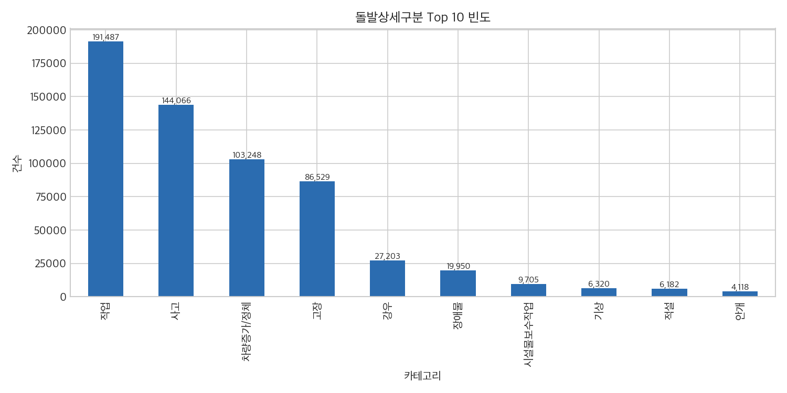

**도로타입 분포**

| 도로타입 | 건수 | 비율 |
|---|---|---|
| 고속국도 | 483,758 | 77.6% |
| 특별광역시도 | 43,892 | 7.0% |
| 일반국도 | 39,729 | 6.4% |
| 도시고속국도 | 23,598 | 3.8% |
| 시군도 | 23,466 | 3.8% |
| 지방도 | 5,183 | 0.8% |
| 국가지원지방도 | 2,702 | 0.4% |
| `-`(미상) | 860 | 0.1% |

### 컬럼 스키마

| 컬럼 | dtype | 결측치 | 설명 |
|---|---|---|---|
| 돌발일시 | object | 0 | 돌발상황 발생 일시 |
| 관리기관 | object | 0 | 도로 관리 기관 |
| 도로타입 | object | 0 | 고속국도/일반국도/도시고속국도 등 도로 분류 |
| 도로번호 | float64 | 698 | 노선 번호(결측 691건은 `도로타입`이 `-`인 행) |
| 도로명 | object | 0 | 노선명 |
| 방향 | object | 87,665 | 진행 방향(기점/종점 등) |
| 돌발구분 | object | 0 | 대분류(기상/공사/교통사고/재난/기타돌발/기타) |
| 돌발상세구분 | object | 0 | 소분류(추돌/차단/작업 등) |
| 돌발내용 | object | 14,291 | 자유 텍스트 상세 내용(위치·차로 정보 포함) |
| X | float64 | 0 | 경도 |
| Y | float64 | 0 | 위도 |
| 링크아이디 | object | 0 | 도로 링크 ID(`-` 8,526건 포함) |
| 돌발종료일시 | object | 0 | 종료 일시(진행중 시 `-`, 366,098건) |
| 요일 | object | 0 | 사건 발생 요일 |
| 요일구분 | object | 0 | 평일/주말/공휴일 구분 |

### 피처 엔지니어링

원본 CSV에는 없는 파생변수를 `src/load_data.py`, `src/region_mapping.py`에서 생성한다.
`요일`/`요일구분`은 원본 팀의 전처리 단계에서 이미 만들어져 raw CSV에 포함돼 있다.

| 변수명 | 생성 로직 | 목적/활용처 | 생성 위치 |
|---|---|---|---|
| `hour` | `돌발일시.dt.hour` | 시간대별 패턴(02번), 시간대 점수 계산(04번) | `load()` 호출 시점 |
| `month` | `돌발일시.dt.month` | `season` 계산의 중간값 | 〃 |
| `season` | `month` → 봄(3-5)/여름(6-8)/가을(9-11)/겨울(12-2) 매핑 | 계절별 분석(02번) | 〃 |
| `지역` | 위경도(X, Y) → `geopandas`로 17개 시/도 행정경계와 point-in-polygon 매칭, 실패 시(약 0.3%) 최근접 시/도로 대체 | 지역별 분석(03번) | `region_mapping.assign_region()` |
| `loc_score`(위치점수) | `돌발내용` 텍스트를 정규식으로 파싱해 터널/교량/IC·JC/고속도로 등 키워드 매칭(0~20점) | 위험도 스코어링(04번) | `risk_scoring.location_score()` |
| `inc_score`(돌발유형점수) | `돌발상세구분`/`돌발구분` 값을 사고·고장·공사·정체·기상 등으로 매핑(0~25점) | 위험도 스코어링(04번) | `risk_scoring.incident_score()` |
| `lane_score`(차로점수) | `돌발내용` 텍스트를 정규식으로 파싱해 전면통제/차로차단 개수/갓길 등 키워드 매칭(0~40점) | 위험도 스코어링(04번) | `risk_scoring.lane_score()` |
| `time_score`(시간점수) | `hour` → 출퇴근/주간/야간 구간 매핑(0~15점) | 위험도 스코어링(04번) | `risk_scoring.time_score()` |
| `처리시간(분)` | `돌발종료일시 - 돌발일시`(진행중 `-`, 데이터 오류 음수값 제외) | 처리시간 분석(06번) | `06_accident_duration.ipynb` |

## 요일·시간대·계절별 패턴(02번 노트북, H2·H3)

**월별 Top 카테고리 최댓값**

| 돌발상세구분 | 최댓값 발생 월 | 건수 | 추세 |
|---|---|---|---|
| 작업 | 9월 | 28,437건 | 1월 최저(7,997건) → 9월까지 증가 → 10월부터 감소 |
| 사고 | 7월 | 18,814건 | 11~4월 낮은 수준 유지 → 5월부터 급증 |
| 차량증가/정체 | 10월 | 12,448건 | 1~9월 비슷한 수준 → 10월에 최댓값 |

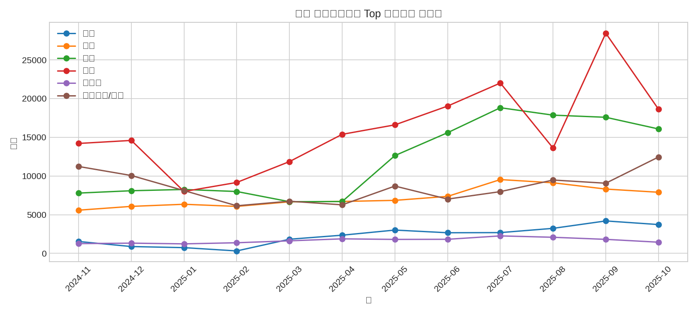

**평일 vs 주말**

| 구분 | 건수 | 비율 |
|---|---|---|
| 평일 | 471,631 | 75.7% |
| 주말 | 125,986 | 20.2% |
| 공휴일 | 25,571 | 4.1% |

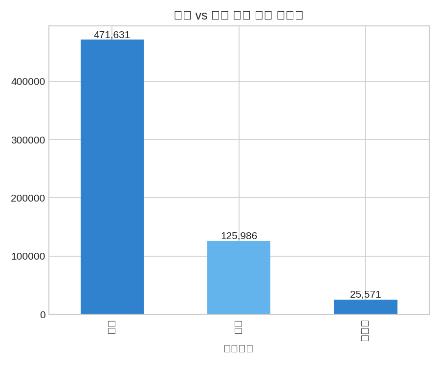

**작업의 요일별 비중**(계획된 공사 위주라 평일에 집중)

| 요일 | 목 | 월 | 화 | 수 | 금 | 토 | 일 |
|---|---|---|---|---|---|---|---|
| 비중 | 20.0% | 19.9% | 19.6% | 19.0% | 13.4% | 4.6% | 3.5% |

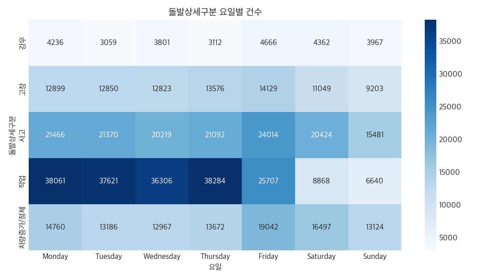

**시간대 피크**

| 구분 | 피크 시간대 | 건수 |
|---|---|---|
| 평일 | 09시 | 52,157건 |
| 주말 | 14시 | 11,727건 |

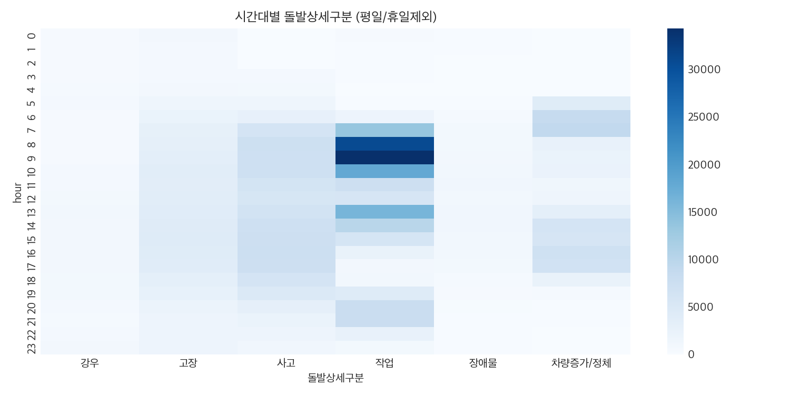
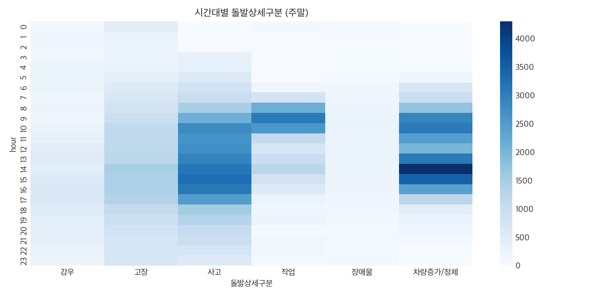

**시간대별 교통사고 비중 Top 5**(07번 노트북 H2 검정의 기초 자료)

| 시간대 | 18시 | 17시 | 19시 | 16시 | 12시 |
|---|---|---|---|---|---|
| 사고 비중 | 38.1% | 34.4% | 33.5% | 31.6% | 30.0% |

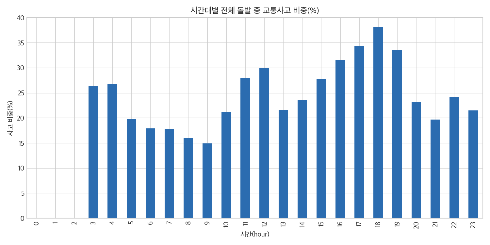

**계절별 발생 건수 및 교통사고 비율**

| 계절 | 전체 발생 건수 | 비율 | 사고 건수 | 전체 대비 사고 비율 |
|---|---|---|---|---|
| 봄 | 137,185 | 22.0% | 26,014 | 19.0% |
| 여름 | 182,764 | 29.3% | 52,262 | 28.6% |
| 가을 | 183,921 | 29.5% | 41,442 | 22.5% |
| 겨울 | 119,318 | 19.1% | 24,348 | 20.4% |

발생 건수는 가을이 근소하게 가장 많지만(29.5%), 전체 대비 사고 비율은 여름이
가장 높다(28.6%). 건수가 몰리는 계절과 사고 위험이 몰리는 계절이 다르다.

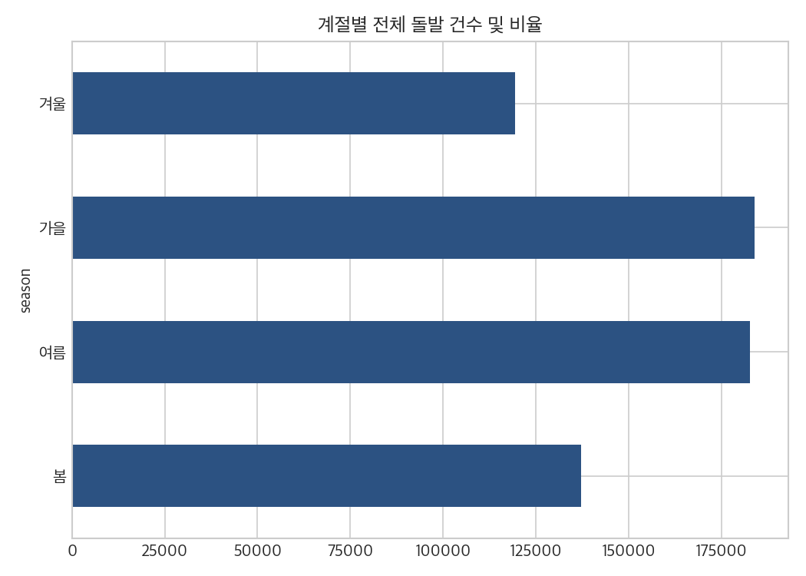

## 도로타입·도로번호·지역별 패턴(03번 노트북, H1)

**도로타입별 돌발구분 구성비(%)**

| 도로타입 | 공사 | 교통사고 | 기상 | 기타 | 기타돌발 | 재난 |
|---|---|---|---|---|---|---|
| 고속국도 | 25.2 | 20.0 | 7.5 | 1.2 | 43.4 | 2.7 |
| 국가지원지방도 | 62.3 | 29.7 | 0.6 | 7.4 | 0.0 | 0.0 |
| 도시고속국도 | 22.7 | 76.0 | 0.6 | 0.7 | 0.0 | 0.0 |
| 시군도 | 76.4 | 17.7 | 1.2 | 4.7 | 0.0 | 0.0 |
| 일반국도 | 63.9 | 25.8 | 0.8 | 2.8 | 6.4 | 0.2 |
| 지방도 | 75.1 | 19.8 | 3.5 | 1.6 | 0.0 | 0.0 |
| 특별광역시도 | 56.0 | 34.4 | 0.7 | 8.8 | 0.0 | 0.0 |

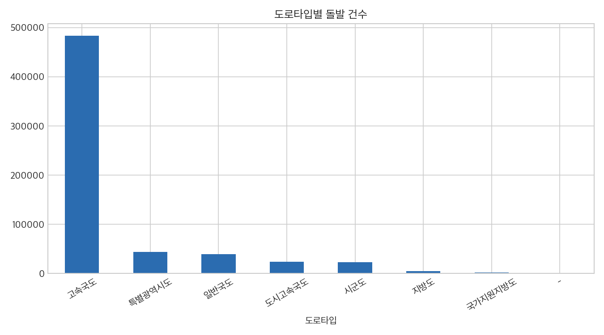
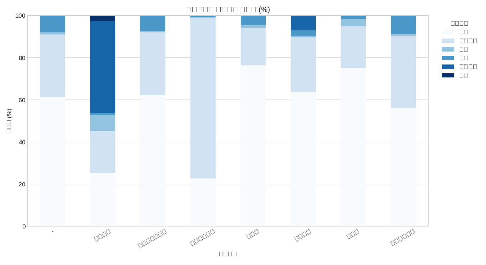

**도로번호별 비중 Top 6**

| 도로번호 | 비중 |
|---|---|
| 0번(다수 일반도로 통합) | 11.9% |
| 1번(경부고속도로) | 11.3% |
| 50번 | 7.1% |
| 100번 | 6.9% |
| 15번 | 6.9% |
| 35번 | 6.1% |

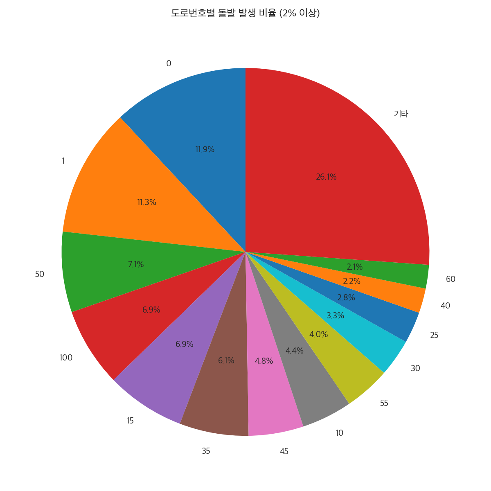

**시/도별 돌발 건수 Top 5**

| 시/도 | 건수 | 비율 |
|---|---|---|
| 경기도 | 163,402 | 26.2% |
| 경상남도 | 58,531 | 9.4% |
| 경상북도 | 52,466 | 8.4% |
| 서울특별시 | 47,366 | 7.6% |
| 충청북도 | 45,833 | 7.4% |

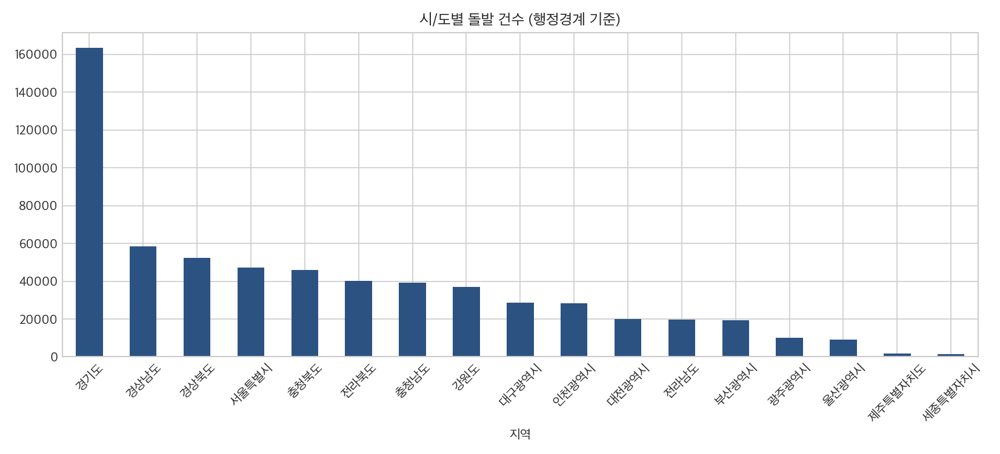

**시/도별 Top1 돌발유형**: 서울특별시만 유일하게 교통사고가 1위이고, 나머지 지역은
대체로 공사 또는 기타돌발(정체/고장류)이 1위다(`03_road_region_analysis.ipynb` 참고).

### 지역 매핑 방법론

`지역` 컬럼은 원본 데이터에 없어 위경도로부터 새로 만들어야 하는 파생 변수다. 통계청
SGIS 2018년 시/도 경계([southkorea/southkorea-maps](https://github.com/southkorea/southkorea-maps)
GeoJSON, `data/boundaries/`, 저장소 용량을 위해 simplify tolerance 0.0005도로 단순화)에
대해 `geopandas`로 위경도 좌표가 실제 어느 폴리곤 안에 있는지(point-in-polygon) 검사해
시/도를 배정한다. 경계 밖으로 판정되는 좌표(해상/GPS 오차, 약 0.3%)는 `sjoin_nearest`로
최근접 시/도에 배정한다. 이 방식으로 나온 전체 1위 지역은 경기도(163,402건)다.

## 도로타입 × 도로번호 딥다이브(05번 노트북, H4)

도로타입 평균만으로는 가려지는, 같은 도로타입 안에서 유독 패턴이 다른 도로를 도로타입별
상위 20개(도로번호 또는 도로명, `특별광역시도`·`시군도`는 도로번호가 항상 0이라 도로명
대체) 단위로 확인했다.

| 도로타입 | 예외 도로 | 최다비중 돌발구분 | 해당 도로 비중 | 도로타입 평균 |
|---|---|---|---|---|
| 고속국도 | 27번 | 공사 | 31.9% | 25.2% |
| 특별광역시도 | 세종대로 | 기타 | 76.8% | 8.8% |
| 일반국도 | 47번 | 교통사고 | 59.6% | 25.8% |
| 도시고속국도 | 112번 | 공사 | 85.1% | 22.7% |
| 시군도 | 구암대로 | 공사 | 61.7% | 76.4% |
| 지방도 | 1020번 | 교통사고 | 73.3% | 19.8% |
| 국가지원지방도 | 58번 | 교통사고 | 61.9% | 29.7% |

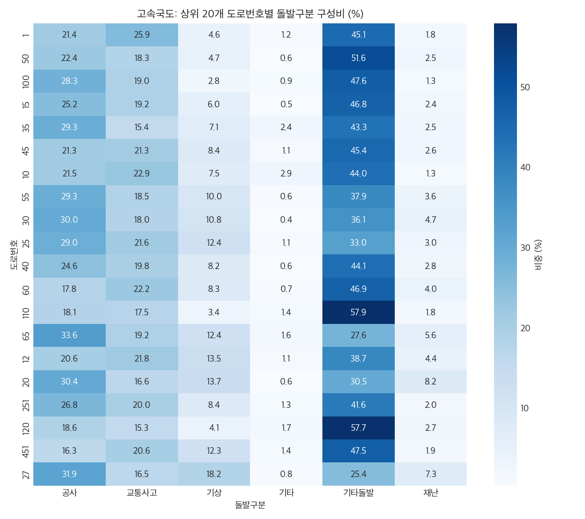
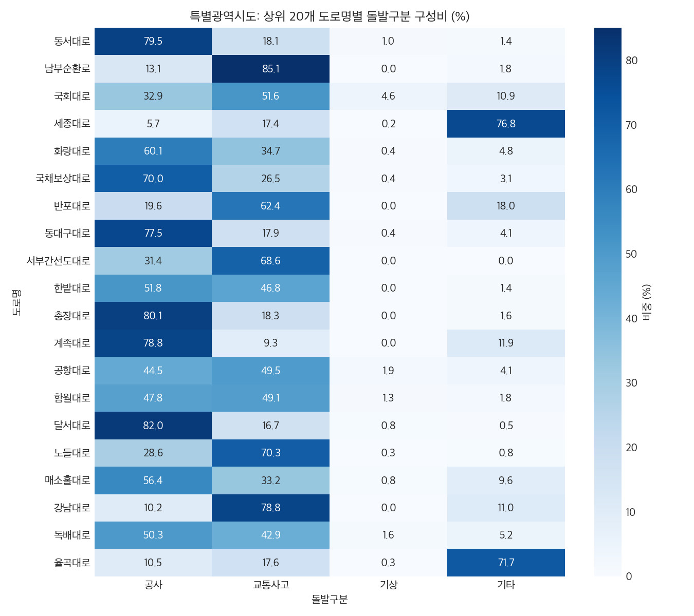
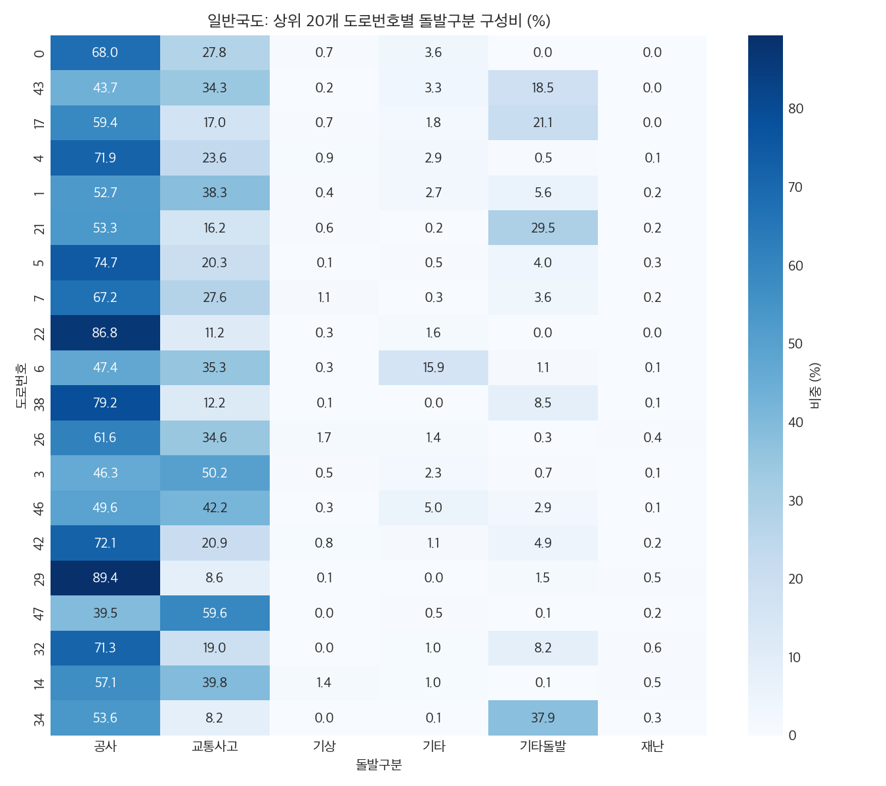
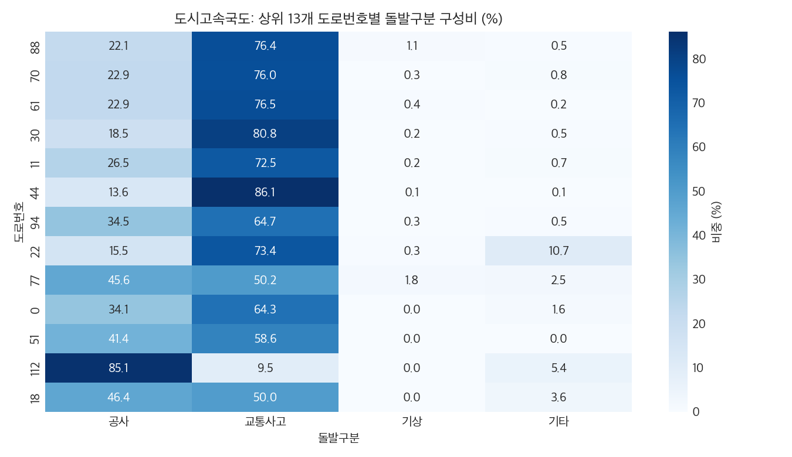
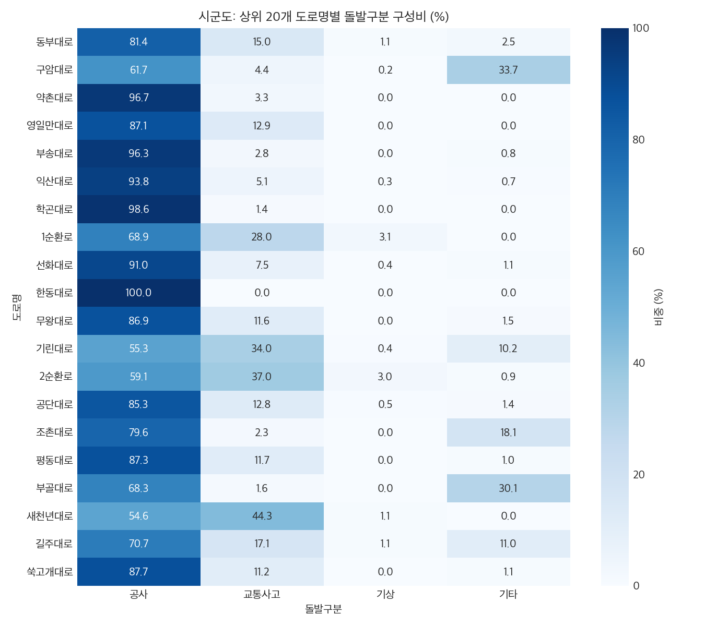
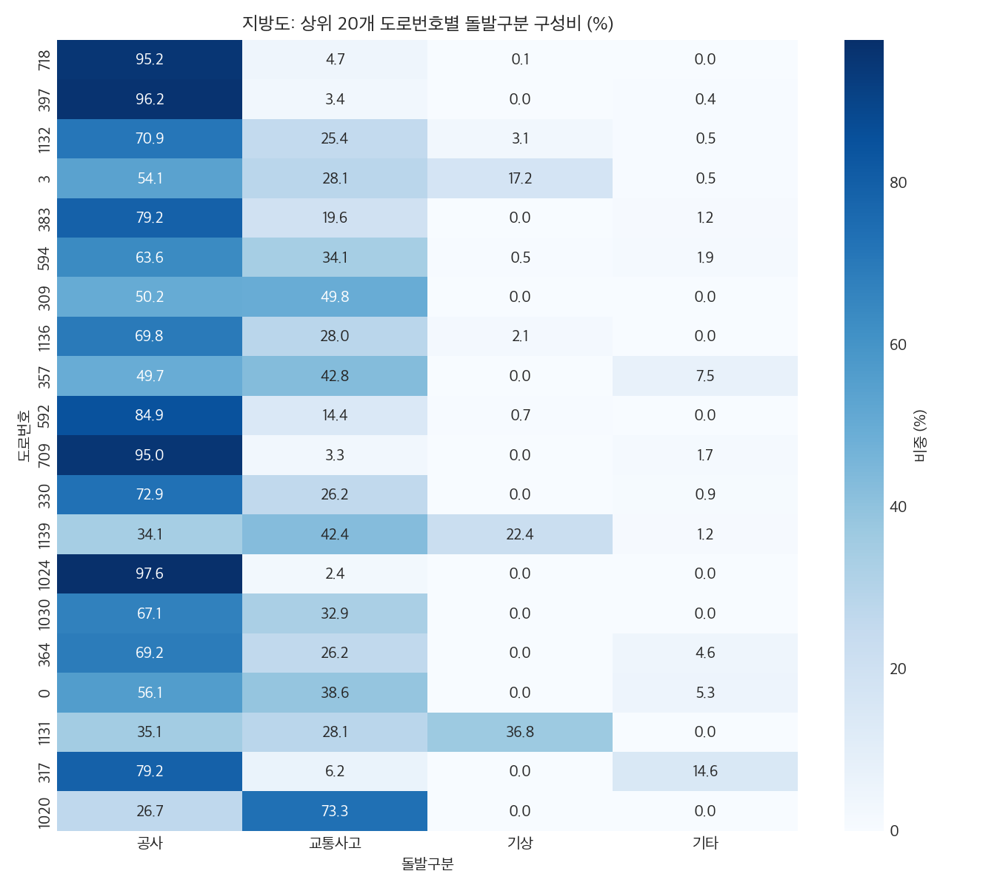
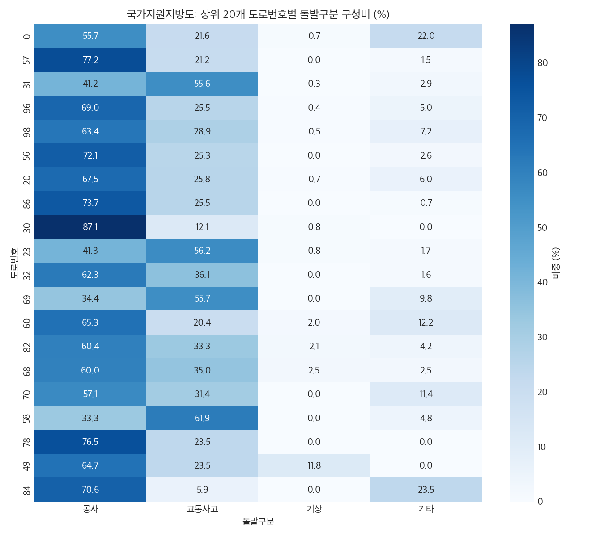

교통량이 많기로 알려진 70·88번(도시고속국도)의 공사 비중도 22.9%/22.1%로 도로타입 평균
(22.7%)과 거의 같게 나타나, 개별 노선의 명성보다 도로타입 자체가 돌발 패턴을 가르는
지배적 요인이라는 결과를 뒷받침한다.

## 처리시간 분석(06번 노트북, H6)

`돌발종료일시 - 돌발일시`로 처리시간(분)을 계산한다(진행중 건·데이터 오류 제외, 총
257,038건).

| 도로타입 | 건수 | 평균(분) | 중앙값(분) | Q1 | Q3 |
|---|---|---|---|---|---|
| 고속국도 | 119,052 | 80.1 | 30.0 | 30.0 | 30.0 |
| 국가지원지방도 | 2,702 | 141.6 | 30.0 | 30.0 | 30.0 |
| 시군도 | 23,466 | 122.0 | 30.0 | 30.0 | 30.0 |
| 지방도 | 5,183 | 493.4 | 30.0 | 30.0 | 30.0 |
| 특별광역시도 | 43,892 | 330.6 | 30.0 | 30.0 | 104.2 |
| 일반국도 | 38,285 | 272.0 | 30.0 | 30.0 | 300.0 |
| 도시고속국도 | 23,598 | 1,524.8 | 30.0 | 30.0 | 30.0 |

**30분 스파이크**: 모든 도로타입에서 중앙값이 정확히 30분이고, 처리 완료 건의
**59.3%(152,388건)**가 정확히 30분으로 기록돼 있다. 실제 현장 처리시간이 우연히
정확히 30분에 몰릴 이유는 없으므로, 이는 실측값이 아니라 종료시각 미입력 시 시스템이
채워 넣는 기본값일 가능성이 높다. 또한 공사 카테고리는 돌발종료일시가 실제 종료가
아니라 수개월~수년 뒤의 공사 예정 종료일로 기록된 경우가 있어(최대 약 2.7년) 평균값이
극단치에 크게 좌우된다. 그래서 도로타입 비교는 평균이 아닌 중앙값·Q1·Q3를 기준으로
해석한다.

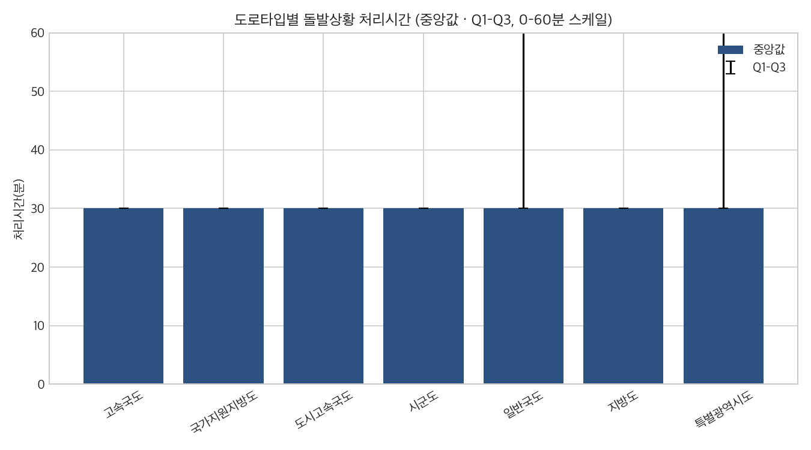

**30분 값 제외 재분석**: 정확히 30분인 값을 모두 제외하고 다시 계산하면 도로타입별로
서로 다른 중앙값이 드러난다.

| 도로타입 | 포함시 중앙값 | 제외시 중앙값 | 포함시 건수 | 제외시 건수 |
|---|---|---|---|---|
| 고속국도 | 30.0 | 32.0 | 119,052 | 41,990 |
| 도시고속국도 | 30.0 | 49.0 | 23,598 | 4,181 |
| 지방도 | 30.0 | 97.0 | 5,183 | 2,153 |
| 특별광역시도 | 30.0 | 120.0 | 43,892 | 21,006 |
| 시군도 | 30.0 | 150.0 | 23,466 | 9,312 |
| 일반국도 | 30.0 | 166.0 | 38,285 | 24,614 |
| 국가지원지방도 | 30.0 | 180.0 | 2,702 | 1,070 |

30분 값을 포함하면 모든 도로타입의 중앙값이 30.0분으로 동일해 애초에 순위를 매길 수
없었다. 30분 값을 제외하고 나서야 고속국도(32.0분)가 가장 빠르고 국가지원지방도
(180.0분)가 가장 느리다는, 이전에는 가려져 있던 도로타입별 실제 처리시간 차이가
드러난다.

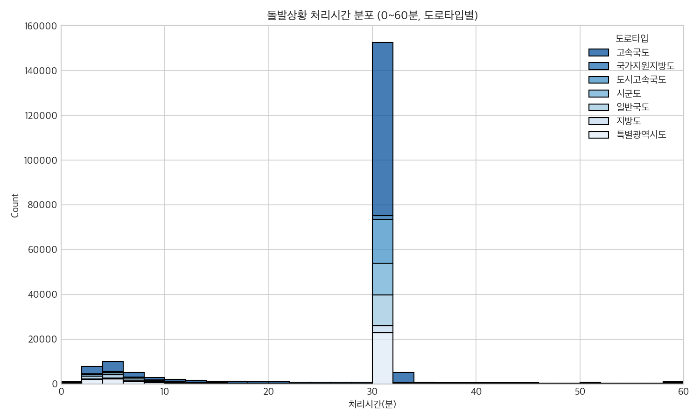

## 위험도 스코어링(04번 노트북, H5)

각 돌발 레코드에 위치·돌발유형·차로통제·시간대 4개 항목을 정규식/키워드 기반으로 채점해
0~100점의 `risk_score`를 산출한다(원본 보고서 2.1.2절 기준표를 그대로 재현).

### 스코어링 기준표

| 항목 | 점수범위 | 세부 기준 | 근거 |
|---|---|---|---|
| 위치 | 0~20 | 터널 20 / 교량·대교·~교 15 / IC·JC·JCT·분기 10 / 고속도로 8 / 일반도로 3(옵션) / 정보없음 0 | 시야 제한·회피 어려움일수록 사고 시 위험 증가 |
| 돌발유형 | 0~25 | 사고 25 / 고장 15 / 공사·작업·시설점검 10 / 정체·지체·서행 5 / 기상 3 / 기타 0 | 급정거·2차사고 가능성이 클수록 영향도 증가 |
| 차로통제 | 0~40 | 전체차로차단/전면통제 40 / 2개 이상 차로차단 30 / 1개 차로차단 20 / 갓길정차·고장 10 / 정보없음 0 | 차단 범위가 넓을수록 정체 파급 증가 |
| 시간대 | 0~15 | 출근 7-9시·퇴근 17-19시 15 / 주간 10-16시 10 / 야간·심야 5 / 정보없음 0 | 동일 돌발이라도 혼잡 시간대일수록 영향 증가 |

전체 `risk_score` 분포: 평균 43.2점, 중앙값 43점, 표준편차 15.9점(최소 8점, 최대 100점).

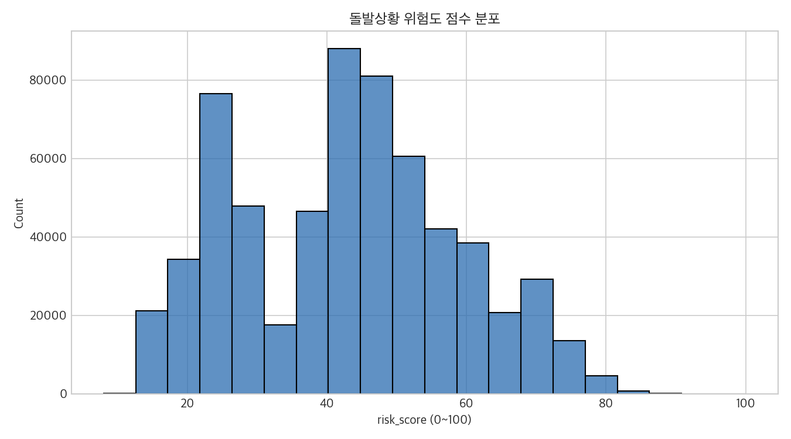

### 카테고리별 평균 위험도(빈도 30건 이상, 상위 5개)

| 돌발상세구분 | 빈도 | 평균 위험도 |
|---|---|---|
| 사고 | 144,066 | 61.1 |
| 역주행 | 319 | 55.2 |
| 화재사고 | 39 | 50.7 |
| 작업 | 191,487 | 47.1 |
| 고장 | 86,529 | 45.2 |

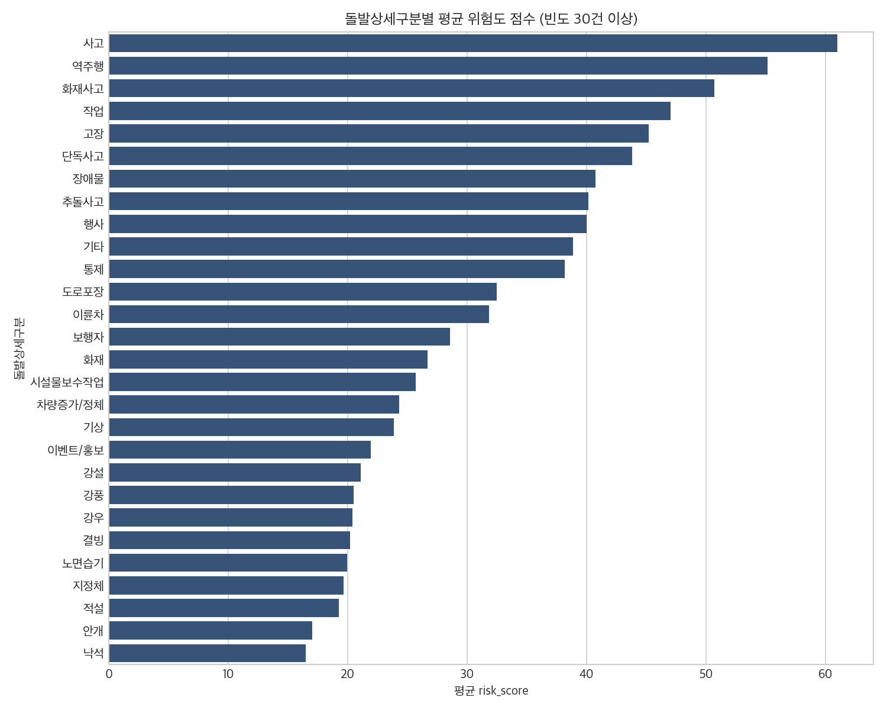

### 위험기여도(빈도 × 평균위험도) Top 5

| 순위 | 돌발상세구분 | 빈도 | 평균 위험도 | 위험기여도 |
|---|---|---|---|---|
| 1 | 작업 | 191,487 | 47.0 | 약 901.8만 |
| 2 | 사고 | 144,066 | 61.0 | 약 880.9만 |
| 3 | 고장 | 86,529 | 45.0 | 약 391.1만 |
| 4 | 차량증가/정체 | 103,248 | 24.0 | 약 251.0만 |
| 5 | 장애물 | 19,950 | 41.0 | 약 81.3만 |

사고는 건당 위험도가 가장 높지만, 건수가 압도적으로 많은 작업이 총 위험기여도로는
근소하게 앞선다.

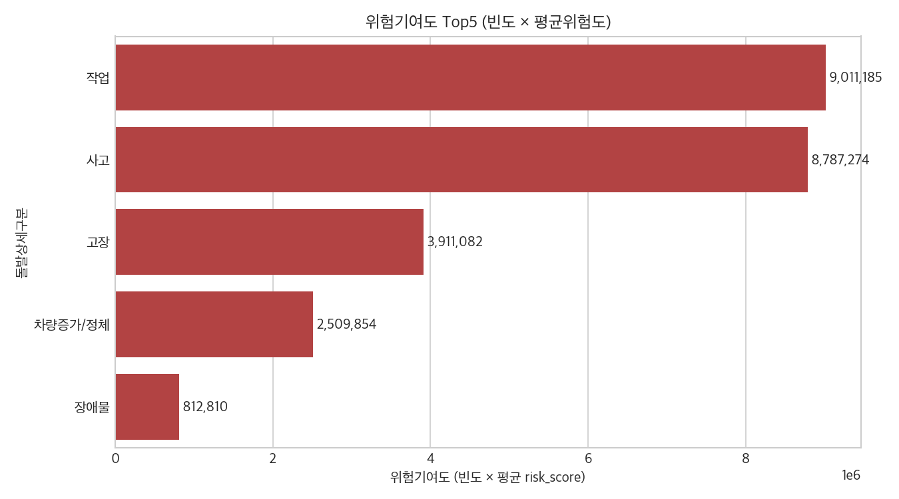

### 위치 × 차로 결합 효과(H5)

위치점수(터널/교량 등, 15점 이상)와 차로점수(2개 이상 차로차단/전면통제, 30점 이상)가
모두 낮은 경우 평균 40.0점인 반면, 둘 다 높은 경우 평균 73.0점까지 올라간다(위치만
높으면 60.9점, 차로만 높으면 59.0점). `risk_score`는 구조상 4개 항목의 단순 합이라
결합 효과가 나타나는 것이 당연하지만, 실제 데이터에서도 이 패턴이 확인된다.

## 통계 검정(07번 노트북, H1·H2·H4)

`07_statistical_tests.ipynb`에서 실행한 결과다.

| 가설 | 검정 | 통계량 | p-value | 효과크기/비율 |
|---|---|---|---|---|
| H1 도로타입 × 돌발구분 | 카이제곱 독립성 검정 | χ²=159,429.6, df=35 | p<0.001 | Cramér's V=0.226(중간) |
| H2 시간대 × 사고여부 | 카이제곱 독립성 검정 | χ²=18,226.9, df=23 | p<0.001 | Cramér's V=0.171(작음~중간) |
| H4 112번 vs 나머지(도시고속국도) | two-proportion z-test | z=12.83 | p<0.001 | 85.1% vs 22.5% |
| H4 1020번 vs 나머지(지방도) | two-proportion z-test | z=9.05 | p<0.001 | 73.3% vs 19.3% |

표본이 623,188건으로 매우 커서 p-value는 H1·H2 모두 0에 가깝게 나온다. 그래서 연관성이
"있다/없다"의 판단은 p-value가 아니라 Cramér's V 같은 효과크기로 한다. H1은 중간 수준의
연관성(V=0.226)으로 도로타입이 돌발구분을 가르는 실질적인 요인임을 뒷받침하지만, H2는
작음~중간 수준(V=0.171)에 그쳐 시간대가 "사고냐 아니냐"를 가르는 힘은 도로타입만큼
강하지 않다. H4의 두 노선(112번, 1020번)은 표본 수가 각각 74건, 45건으로 크지 않은데도
비율 차이 자체가 3~4배로 커서 통계적으로 유의한 결과가 나왔다. 상세 해석은
[`notebooks/07_statistical_tests.ipynb`](../notebooks/07_statistical_tests.ipynb) 참고.

## 가설 전체 요약

| # | 가설 | 검증 노트북 | 결과 | 검정 결과 |
|---|---|---|---|---|
| H1 | 도로타입에 따라 주요 돌발유형 구성비가 다르게 나타난다 | 03, 07 | 채택 | χ²=159,429.6, p<0.001, V=0.226 |
| H2 | 돌발은 출근 시간대(07-09시)에 집중되고, 교통사고 비중은 퇴근 시간대(18-19시)에 최고치를 보인다 | 02, 07 | 채택 | χ²=18,226.9, p<0.001, V=0.171 |
| H3 | 계절적 요인에 따라 돌발 패턴이 다르다(가을=공사, 여름=사고) | 02 | 채택 | 별도 검정 없음(기술통계) |
| H4 | 같은 도로타입이어도 특정 도로는 평균 패턴과 다른 고유 패턴을 보인다 | 05, 07 | 채택 | 112번 z=12.83, 1020번 z=9.05(둘 다 p<0.001) |
| H5 | 위치·차로통제·시간대가 결합될수록 위험도가 커진다 | 04 | 채택 | 별도 검정 없음(기술통계) |
| H6 | 기록된 처리시간 중 상당수는 실제 처리시간이 아닌 시스템 기본값/보고 관행에 의한 아티팩트다 | 06 | 채택 | 별도 검정 없음(기술통계) |

H3·H5·H6은 분포 비교와 구조적 설명으로 뒷받침한 가설이라 이번 07번 노트북에서는 별도
통계검정을 수행하지 않았다.
